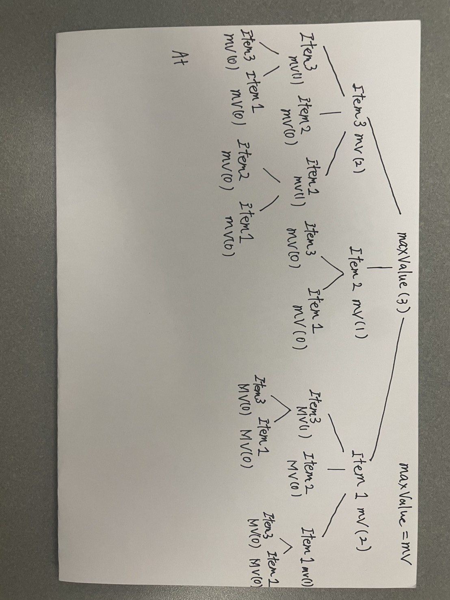

# Lab 07: The Integer-Valued Knapsack Problem

**Name:** _______________________  

## Introduction
In this lab, you will explore different variations of the Knapsack problem and design a dynamic programming solution for one of them. You may work in small groups or individually, but everyone should write up their own answers to the questions below. 

Suppose we're going hiking. We have items $1, \ldots, n$ that we could pack in multiples with corresponding values $v_1, \ldots, v_n$ and weights $w_1, \ldots, w_n$. For example, we might have a water bottle (weight 1, value 2) and a sandwich (weight 2, value 5). Consider the following three problem variations:

1. Maximize value subject to capacity $W$, where you can pack at most one of each item.
2. Maximize value subject to capacity $W$, where you can pack a positive integer value of each item.
3. Minimize weight subject to minimum value $V$, where you can pack a positive integer value of each item.

---

## Part 1: Dynamic Programming Fundamentals

**Question:** Which of the three problem variations can be solved using the dynamic programming approaches we've studied in lecture? Explain your reasoning.

*Your Answer:*

All three variations can be solved using dynamic programming because they have **optimal substructure** and **overlapping subproblems**. An optimal solution can be constructed from optimal solutions to smaller problems, and the answers to repeated subproblems can be stored and reused.

1. **Maximize value with at most one of each item:** Define $DP(i,c)$ as the maximum value achievable using the first $i$ items with capacity $c$. For each item, compare excluding it with including it once. Both choices use only the first $i-1$ items for the remaining problem, preventing an item from being selected more than once.

2. **Maximize value with multiple copies allowed:** Define $DP(c)$ as the maximum value achievable with capacity $c$. Choosing one copy of item $i$ adds value $v_i$ and leaves a smaller problem with capacity $c-w_i$. The same item remains available in that smaller problem, allowing repeated selections. Store the maximum value over all feasible choices.

3. **Minimize weight while achieving at least value $V$:** Define $DP(t)$ as the minimum weight needed to achieve at least the remaining required value $t$. Choosing item $i$ adds weight $w_i$ and reduces the remaining requirement to $\max(0,t-v_i)$. Compare all choices and store the minimum weight, with $DP(0)=0$.

Thus, changing the objective from maximization to minimization or allowing repeated items changes the states and transitions, but does not prevent dynamic programming from being used.

These formulations assume positive integer weights and values. If "a positive integer" in variations 2 and 3 means that **at least one copy of every item is required**, first include one of each item and then apply DP to the remaining capacity or value requirement, provided the initial selection is feasible.

## Part 2: The Naive Recursive Algorithm

Below is a naive recursive algorithm intended to solve one of the variations listed above.

```text
Function MaxValue(W):
    if W == 0:
        return 0
        
    max_val = 0
    for i from 1 to n:
        if w_i <= W:
            current_val = v_i + MaxValue(W - w_i)
            if current_val > max_val:
                max_val = current_val
                
    return max_val
```

**Question:** Which of the three problem variations (1, 2, or 3) does this algorithm solve? How do you know? Explain your reasoning.

*Your Answer:*

The algorithm solves **Variation 2**, interpreted as allowing unlimited copies of each item. It maximizes value by comparing $v_i + \text{MaxValue}(W-w_i)$ for every item that fits and returning the largest result. The condition $w_i \leq W$ prevents exceeding the capacity. Each recursive call considers all items again, so the same item can be selected repeatedly, unlike Variation 1. It does not solve Variation 3 because it maximizes value under a weight limit rather than minimizing weight to meet a value requirement. Strictly speaking, the code allows zero copies of an item; it does not require at least one of every item if "positive integer" is read literally.

## Part 3: Recursion Tree

Consider the following simple example:
* **Knapsack Capacity:** $W = 3$
* **Item 1:** Weight $w_1 = 1$, Value $v_1 = 2$
* **Item 2:** Weight $w_2 = 2$, Value $v_2 = 5$
* **Item 3:** Weight $w_3 = 1$, Value $v_3 = 3$

**Question:** Draw the full recursion tree for `MaxValue(3)` using the example above. Label the remaining capacity at each node and indicate which item is chosen along each branch.

*Your Answer (take a picture and upload it):*



## Part 4: Recurrence Relation

**Question:** Derive a mathematical recurrence relation for $OPT(W)$, the maximum value you can pack into a knapsack of capacity $W$, based on the naive recursive algorithm. Be sure to state your base case(s) and explain how you arrived at your formula.

*Your Answer:*

Assuming positive integer weights and a nonnegative integer capacity, let $OPT(W)$ be the maximum total value achievable with weight at most $W$, allowing unlimited copies of each item. Then

$$
OPT(W)=
\begin{cases}
0, & W=0, \\
\max\left(\{0\}\cup\{v_i+OPT(W-w_i)\mid 1\leq i\leq n,\ w_i\leq W\}\right), & W>0.
\end{cases}
$$

The base case is 0 because no item fits in a knapsack of capacity 0. For each item $i$ that fits, choosing one copy contributes $v_i$ and leaves capacity $W-w_i$. The best additional value is $OPT(W-w_i)$, where all items, including item $i$, remain available. Taking the maximum over these choices gives the optimal value. Including 0 represents choosing nothing and ensures that $OPT(W)=0$ when no item fits. Since every weight is positive, each recursive subproblem has a smaller capacity.

## Part 5: Bottom-Up Dynamic Programming

Instead of using the slow recursive approach, we can build a table bottom-up. 

**Question:** Use your recurrence relation from Part 4 to fill in the following table for the example provided in Part 3 ($w_1=1, v_1=2$ and $w_2=2, v_2=5$). At each step, record the optimal value and the specific item chosen to achieve that value. 

Using the two items explicitly listed in Part 5, the table is shown below. "Item Chosen" records one item selected at the current capacity; the remaining items come from the row for the remaining capacity. When both choices tie, choose Item 1.

| Capacity ($W$) | Optimal Value ($OPT$) | Item Chosen |
|:---:|:---|:---|
| **0** | 0 | None |
| **1** | 2 | Item 1 |
| **2** | 5 | Item 2 |
| **3** | 7 | Item 1 |
| **4** | 10 | Item 2 |
| **5** | 12 | Item 1 |
| **6** | 15 | Item 2 |

*Explain how you calculated the row for $W=6$*

Choosing Item 1 gives $2+OPT(5)=2+12=14$. Choosing Item 2 gives $5+OPT(4)=5+10=15$. Therefore, $OPT(6)=\max(0,14,15)=15$, and the recorded choice is Item 2.

## Part 6: Traceback

**Question:** Using the "Item Chosen" column from the table you completed in Part 5, trace back to find the exact quantities of each item to pack that maximize the value. What is the final optimal packing configuration for $W=6$ and the maximum value?

*Your Answer:*

Starting at $W=6$, follow the "Item Chosen" column:

- $W=6$: Choose Item 2; remaining capacity $=6-2=4$.
- $W=4$: Choose Item 2; remaining capacity $=4-2=2$.
- $W=2$: Choose Item 2; remaining capacity $=2-2=0$.

Therefore, the optimal packing is **0 copies of Item 1 and 3 copies of Item 2**, with total weight $3\times 2=6$ and maximum value $3\times 5=\boxed{15}$.
